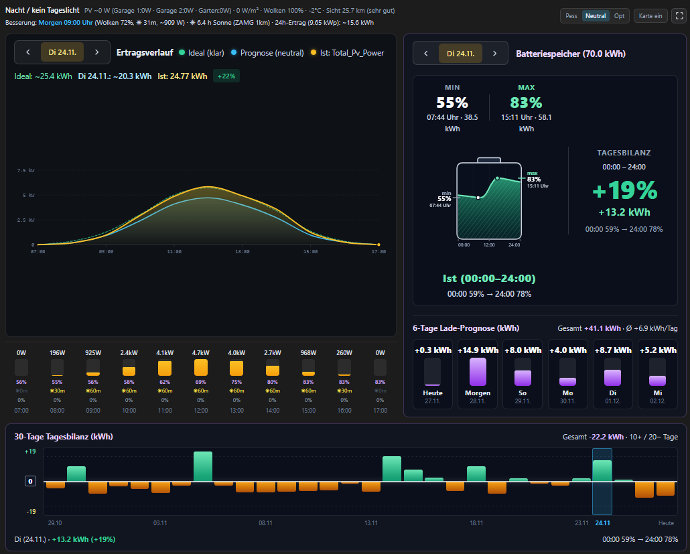

# PV-Cockpit für Home Assistant

Eine eigenständige Home-Assistant-Lovelace-Karte (`custom:pv-cockpit-card`) für präzise PV-Ertragsprognosen, physikalische Verschattungskalibrierung pro Dachstring, historischen `Ist`-Abgleich, integrierte **Batteriespeicher-Analyse** (Tagesbilanz, 6-Tage Lade-Prognose & 30-Tage Bilanz) und eine optional einblendbare Wetterradar-Karte — **komplett ohne Build-Prozess und ohne API-Keys**.

---

## Ansicht: Ertragsverlauf & Batteriespeicher-Analyse

Gesamtansicht einer kalibrierten Multi-String-Anlage im 2-Spalten-Layout – links `Ideal (klar)` vs. `Prognose` vs. tatsächlichem `Ist`-Verlauf (`Di 24.11.: Prognose ~20.3 kWh · Ist 24.77 kWh / +22%`), rechts **Batteriespeicher (`70.0 kWh`)** mit Tagesbilanz (`+19% / +13.2 kWh`) und **6-Tage Lade-Prognose**, darunter die **30-Tage Tagesbilanz**:

<p align="center">
  <br />
  <sub><strong>PV-Cockpit Gesamtansicht (Di 24.11.)</strong> · Ertragsverlauf (Ideal ~25.4 kWh · Prognose ~20.3 kWh · Ist 24.77 kWh) &amp; Batteriespeicher (70.0 kWh, Tagesbilanz +19% / +13.2 kWh)</sub>
</p>

---

## Highlights

- **Pro-String-PV-Modell:** Beliebig viele Strings/Dachflächen mit individueller Modulanzahl, Modulleistung (`Wp`), Ausrichtung (`Azimut 0–360°`), Neigung (`0–90°`), eigenem `Ist`-Sensor und string-spezifischer Verschattung.
- **Unabhängige Idealkurve (`Ideal (klar)`):** Physikalische Clear-Sky-Referenzkurve (inkl. Temperatur-/Windeinfluss & Standortverschattung), unabhängig vom gewählten Prognose-Modus (`Pess` / `Neutral` / `Opt`).
- **Automatische Sonnentag-Kalibrierung:** Wähle im visuellen Editor ein klares Sonnentagsdatum (global oder pro String) – die Karte erkennt Baum-, Gebäude- und Horizontschatten inkl. Restlichtanteil automatisch aus deinen Home-Assistant-Messdaten.
- **Präziser Ist-Abgleich (`W`, `kW`, `Wh`, `kWh`):** Zeitgewichtete Wh-Integration direkt aus der Home-Assistant-History über `pv_actual_entity` (Pflichtfeld im visuellen Editor) sowie optional einzelne String-Sensoren – auch bei gemischten Leistungs- (`W`/`kW`) und Energiezählern (`kWh`).
- **Batteriespeicher-Analyse (`battery_system`):**
  - **Batteriegrafik mit Tagesbilanz:** Live- und historischer SoC-Verlauf (`Min` / `Aktuell` / `Max`) inklusive markanter **Tagesbilanz (`00:00–24:00` bzw. `00:00–Jetzt`: Δ % & Δ kWh)** direkt rechts neben der Batterie.
  - **6-Tage Lade-Prognose (`kWh`):** Kompakter Überblick über die voraussichtlich geladenen `kWh` der nächsten 6 Tage; jeder Tag ist direkt anklickbar.
  - **30-Tage Tagesbilanz (`kWh`):** Balkendiagramm der Netto-Tagesbilanzen der letzten 30 Tage mit klarer `0`-Linie, fester Y-Achse, breiten Balken und automatischem Scroll auf die aktuellsten Tage (`Heute` ganz rechts).
- **Synchronisierte Tagesnavigation (`‹ Heute ›`):**
  - Direkt sowohl beim **Ertragsverlauf** als auch beim **Batteriespeicher** linksbündig bedienbar (mit vergrößerten Touch-Flächen für Smartphones).
  - Bis zu **7 Tage voraus** (`Heute`, `Morgen`, `+6 Tage`) und bis zu **30 Tage zurück** (inkl. historischem Wetter, PV-`Ist`-Verlauf und SoC-Historie).
  - Strikte `00:00 – 24:00`-Darstellung synchron zwischen Verlaufsgraph, Stundenbalken und Speicher-Ansicht.
- **Responsives 2-Spalten- & Vollbild-Layout:**
  - Auf Smartphones und schmalen Karten übersichtlich untereinander gestapelt.
  - Auf breiten Desktop-Ansichten (ab `960 px` Kartenbreite) sowie im **Vollbildmodus** automatisch als kompaktes 2-Spalten-Layout (links Ertragsverlauf + Stundenwerte, rechts Batteriespeicher + 6-Tage Lade-Prognose, darunter die 30-Tage Tagesbilanz über die volle Breite) – inklusive proportionaler Vollbild-Skalierung ohne Abschneiden.
- **Multi-Modell-Wetterphysik:** Kombiniert Open-Meteo (`GHI`/`DNI`/`DHI`/Sonnenscheindauer/Nebel/Sichtweite), GeoSphere Austria / ZAMG (`1 km NWP` für Österreich & Nachbarregionen) sowie optional eine lokale `weather.*`-Entität (z. B. Met.no als Fallback & Abgleich).
- **Optionale Wetterradar-Karte:** RainViewer-Regenradar (animiert), DWD-Meteosat-Wolkenfilm, GeoSphere/ZAMG-Wetterwarnungen (Österreich), Ortsnamen-Layer und Vollbildmodus – per Klick direkt ein- und ausblendbar.

---

## Installation

### Variante 1: Manuelle Installation (empfohlen bis HACS-Aufnahme)

1. Lade die Datei [`pv-cockpit-card.js`](pv-cockpit-card.js) herunter und lege sie in Home Assistant unter:
   ```text
   /config/www/pv-cockpit-card.js
   ```
2. Füge in Home Assistant unter **Einstellungen → Dashboards → Ressourcen** (oben rechts ⋮) eine neue Ressource hinzu:
   - **URL:** `/local/pv-cockpit-card.js`
   - **Typ:** `JavaScript-Modul`
   *(Bei Updates eine Versionsnummer anhängen, z. B. `/local/pv-cockpit-card.js?v=23`, oder Cache mit `Strg+Shift+R` leeren.)*
3. Danach ist die Karte im Dashboard-Editor als **„PV-Cockpit“** verfügbar.

### Variante 2: HACS (Benutzerdefiniertes Repository)

1. Öffne **HACS → Frontend → ⋮ → Benutzerdefinierte Repositories**.
2. Füge die URL dieses GitHub-Repositories mit Kategorie **Dashboard** / **Lovelace** hinzu und installiere **PV-Cockpit**.
3. Lade das Frontend einmal neu (`Strg+Shift+R`).

---

## Konfiguration

Die Karte lässt sich vollständig über den **visuellen Lovelace-Editor** konfigurieren. Alternativ funktioniert auch direktes Dashboard-YAML:

### Beispiel-YAML (Multi-String-Anlage mit Batteriespeicher)

```yaml
type: custom:pv-cockpit-card
title: PV-Cockpit
pv_mode: neutral
show_pv_panel: true
show_battery_panel: true
show_map: false
hide_night: false
pv_actual_entity: sensor.pv_power_total
weather_entity: weather.forecast_home
pv_system:
  strings:
    - id: garage_vorne
      name: Garage Vorne
      count: 6
      watt: 440
      azimuth: 180
      tilt: 25
      actual_entity: sensor.inverter_pv1_power
    - id: dach_suedost
      name: Dach SO
      count: 10
      watt: 440
      azimuth: 135
      tilt: 30
      actual_entity: sensor.inverter_pv2_power
    - id: dach_nordwest
      name: Dach NW
      count: 5
      watt: 460
      azimuth: 315
      tilt: 25
      actual_entity: sensor.inverter_pv3_power
battery_system:
  enabled: true
  capacity_kwh: 70
  soc_entity: sensor.battery_soc
```

> **Hinweis zu `Ist`-Sensoren:** Für `pv_actual_entity` eignen sich am besten **Leistungssensoren (`W` / `kW`)**, da diese zusätzlich die aktuelle Live-Leistung und fein aufgelöste Stundenkurven liefern – **Energiezähler (`Wh` / `kWh`)** werden aber ebenfalls automatisch erkannt. Wenn pro String zusätzlich eigene `actual_entity`-Sensoren hinterlegt sind, stehen diese u. a. für string-spezifische Vergleiche und Kalibrierung zur Verfügung.

---

## Parameter-Referenz

### PV-Anlage & Sensoren

| Option | Typ | Standard | Beschreibung |
| --- | --- | --- | --- |
| `pv_actual_entity` | `string` | *(Pflicht im Editor)* | Globaler Leistungs- (`W`/`kW`) oder Energiezähler (`Wh`/`kWh`) für die `Ist`-Kurve |
| `pv_mode` | `string` | `neutral` | Prognose-Charakter: `pessimistisch`, `neutral`, `optimistisch` |
| `pv_system.strings` | `list` | `[]` | Liste der PV-Strings (`id`, `name`, `count`, `watt`, `azimuth`, `tilt`, `actual_entity`, `shading`, `shading_date`) |
| `weather_entity` | `string` | – | Optionale HA-Wetterentität (z. B. `weather.forecast_home`) für lokalen Wolken-/Temp.-Abgleich & Offline-Fallback |
| `pv_shading` | `list` | `[]` | Globale Verschattungssektoren (`from_azimuth`, `to_azimuth`, `min_elevation`, `diffuse_transmission`), falls nicht pro String gesetzt |
| `pv_shading_date` | `string` | – | Datum (`YYYY-MM-DD`) der letzten globalen Sonnentag-Kalibrierung |
| `show_pv_panel` | `boolean` | `true` | PV-Diagnose, Verlaufsgraph und Stundenbalken anzeigen |
| `hide_night` | `boolean` | `false` | Nachtstunden ohne Einstrahlung im Chart und in den Balken ausblenden |

### Batteriespeicher (`battery_system`)

| Option | Typ | Standard | Beschreibung |
| --- | --- | --- | --- |
| `show_battery_panel` | `boolean` | `true` | Batterie-Bereich in der Karte anzeigen/ausblenden |
| `battery_system.enabled` | `boolean` | `true` | Aktiviert Batteriegrafik, Tagesbilanz, 6-Tage Lade-Prognose und 30-Tage Bilanz |
| `battery_system.capacity_kwh` | `number` | `10` | Nutzbare Speicherkapazität in `kWh` (z. B. `70`) |
| `battery_system.soc_entity` | `string` | – | HA-Sensor für aktuellen Speicher-SoC (`%`) für Ist-Verlauf, Tagesbilanz & 30-Tage-Historie |
| `battery_system.power_entity` | `string` | – | Optional: HA-Sensor für aktuelle Lade-/Entladeleistung (`W` / `kW`) |
| `battery_system.min_soc_pct` | `number` | `10` | Optional (YAML): Untere SoC-Reserve (`%`) für die Lade-Prognose |
| `battery_system.max_soc_pct` | `number` | `100` | Optional (YAML): Obere Ladebegrenzung (`%`) |
| `battery_system.max_charge_kw` | `number` | `5.0` | Optional (YAML): Maximale Ladeleistung (`kW`) |
| `battery_system.max_discharge_kw` | `number` | `5.0` | Optional (YAML): Maximale Entladeleistung (`kW`) |
| `battery_system.efficiency_pct` | `number` | `92` | Optional (YAML): Roundtrip-Wirkungsgrad (`%`) |
| `battery_system.initial_soc_pct` | `number` | `30` | Optional (YAML): Start-SoC (`%`), falls noch keine Ist-Historie vorliegt |

### Standort & optionale Wetterkarte

| Option | Typ | Standard | Beschreibung |
| --- | --- | --- | --- |
| `latitude` | `number` | *HA-Home* | Breitengrad des Standorts (Fallback ohne HA-Standort: `48.3003`) |
| `longitude` | `number` | *HA-Home* | Längengrad des Standorts (Fallback ohne HA-Standort: `14.2858`) |
| `show_map` | `boolean` | `true` | Wetterradar-Karte standardmäßig ausgeklappt anzeigen |
| `height` | `string` | `450px` | Höhe des Karten-Bereichs (z. B. `450px`) |
| `zoom` | `number` | `7` | Initialer Zoom-Faktor der Karte (`3–15`) |
| `auto_play` | `boolean` | `true` | Radar-Animation automatisch starten |
| `opacity` | `number` | `0.75` | Transparenz von Radar und Satellitenwolken (`0.0–1.0`) |
| `show_radar` | `boolean` | `true` | RainViewer-Regenradar beim Öffnen aktiv |
| `show_clouds` | `boolean` | `true` | DWD-Meteosat-Wolkenfilm beim Öffnen aktiv |
| `show_warnings` | `boolean` | `false` | GeoSphere/ZAMG-Wetterwarnungen anzeigen (nur Österreich) |
| `carto_api_key` | `string` | – | Optionaler CartoDB-Key für Dark-Matter-Basemap (Standard nutzt Esri Dark Gray kostenlos ohne Key) |

---

## Funktionsweise im Detail

### 1. Kalibrierung anhand eines klaren Sonnentags
1. Öffne den **visuellen Editor** der Karte.
2. Hinterlege bei `pv_actual_entity` deinen PV-Gesamtsensor (und optional pro String den jeweiligen String-Sensor `actual_entity`).
3. Wähle im Bereich **Verschattung (Sonnentag-Kalibrierung)** (pro String oder global) ein Datum, an dem der Himmel weitgehend wolkenlos war, und klicke auf **„Aus Sonnentag kalibrieren“**.
4. Die Karte lädt die 15-Minuten-Messwerte aus deiner HA-History, vergleicht sie mit dem theoretischen Sonnenstand (Azimut & Elevation) für diesen Tag und erzeugt daraus passende Horizont- und Teilschatten-Sektoren (z. B. Nachbarsdach mit 0 % Restlicht vs. Baumkrone mit 25 % Restlicht).

### 2. Zentrierte Stundenfenster
Open-Meteo und GeoSphere/ZAMG liefern stündliche Strahlungs- und Sonnenscheindaten rückblickend für `[HH−1h, HH]`. **PV-Cockpit** richtet Strahlung, Sonnenstand und Home-Assistant-`Ist`-Integration einheitlich auf das **zentrierte Stundenfenster `[HH − 30 Min, HH + 30 Min]`** aus, sodass `Ideal`, `Prognose`, `Ist` und der `"Jetzt"`-Marker zeitlich exakt übereinanderliegen.

### 3. Batteriespeicher-Tagesbilanz & 30-Tage-Verlauf
Die Tagesbilanz rechts neben der Batterie vergleicht den SoC zu Tagesbeginn (`00:00`) mit dem aktuellen Wert (`00:00 – Jetzt` bei `Heute`) bzw. dem Tagesendwert (`00:00 – 24:00` bei vergangenen Tagen): `Δ SoC (%) = SoC(Ende) − SoC(00:00)` sowie umgerechnet in `kWh` anhand von `capacity_kwh`. Im 30-Tage-Diagramm werden genau diese täglichen Netto-Bilanzen (inkl. dynamischem `Heute`-Wert ganz rechts) dargestellt.

---

## Datenquellen & Lizenzen

Alle genutzten Dienste sind frei zugänglich und benötigen keinen API-Schlüssel:

- **Strahlung & Wettermodell:** [Open-Meteo](https://open-meteo.com/) (CC BY 4.0)
- **Alpenraum NWP (1 km) & Warnungen:** [GeoSphere Austria / ZAMG Data Hub](https://data.hub.geosphere.at/) (CC BY 4.0)
- **Satellitenwolken:** Deutscher Wetterdienst (DWD) – WMS (GeoNutzV)
- **Regenradar:** [RainViewer API](https://www.rainviewer.com/)
- **Kartenbasis & Orte:** Esri Dark Gray Canvas · [GeoNames](https://www.geonames.org/) (CC BY 4.0) · [Leaflet](https://leafletjs.com/) (BSD-2-Clause)

---

## Rechtlicher Hinweis

Die Nutzung externer Open-Data-Dienste (Open-Meteo, GeoSphere Austria, DWD, RainViewer) erfolgt direkt durch den Browser des Nutzers im Rahmen der jeweiligen nicht-kommerziellen / Open-Data-Nutzungsbedingungen der Anbieter.
